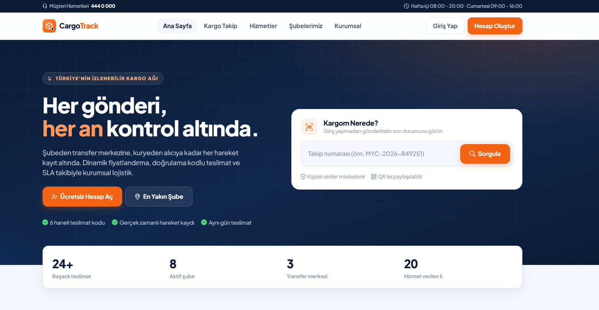
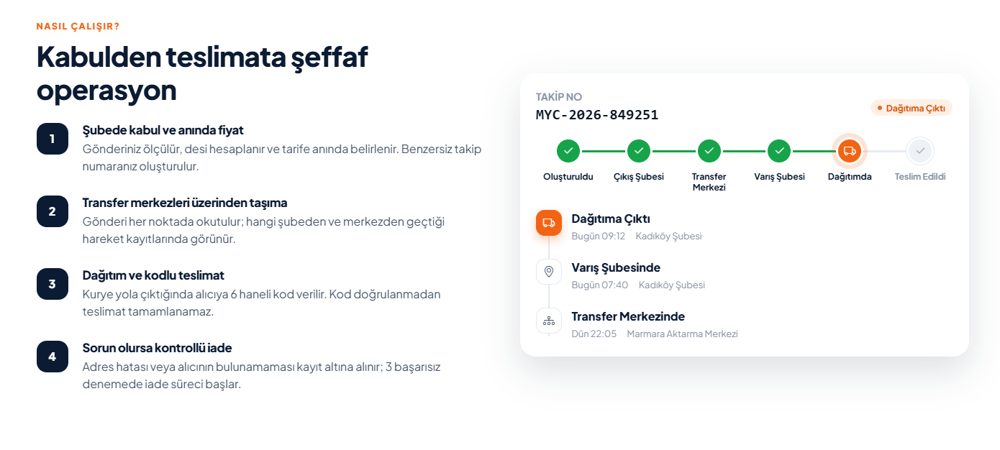
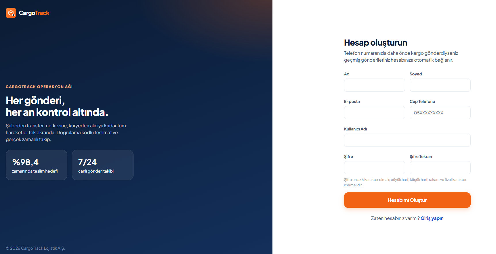
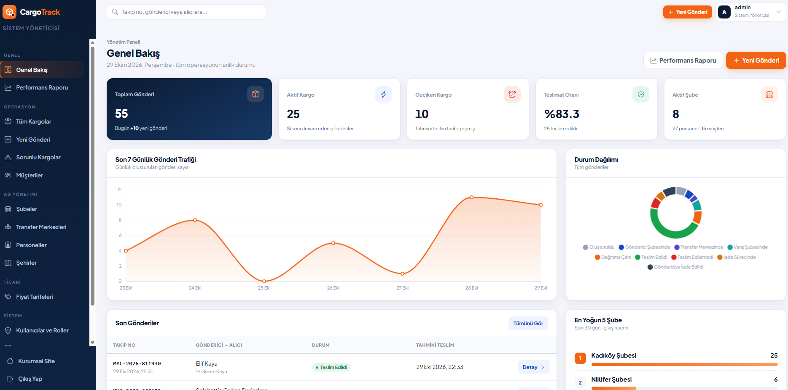
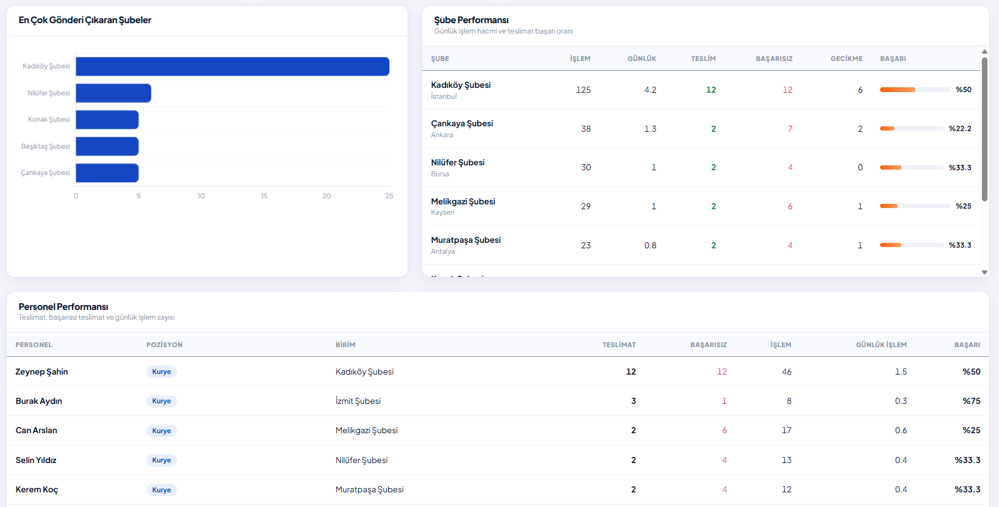
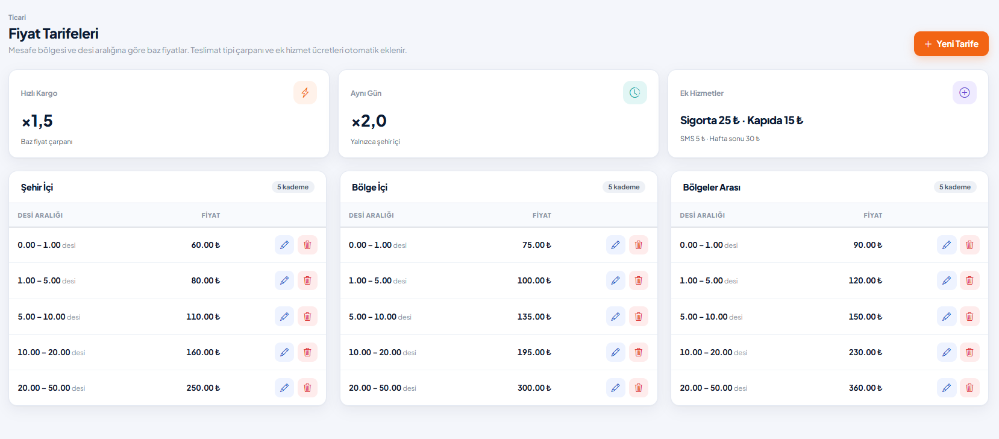
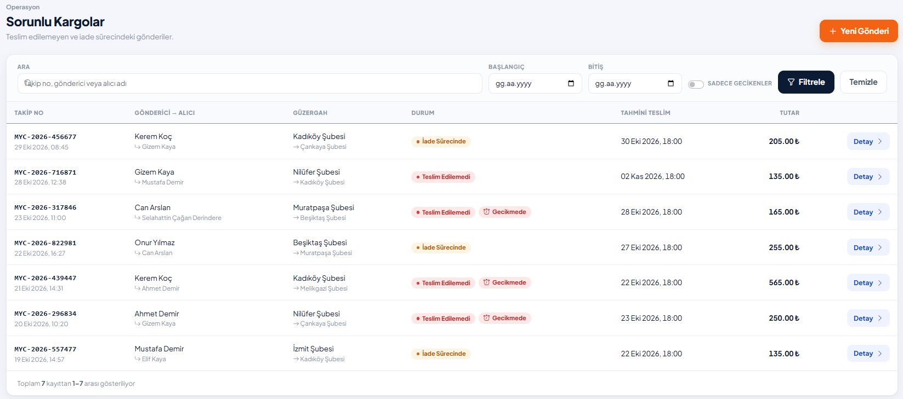
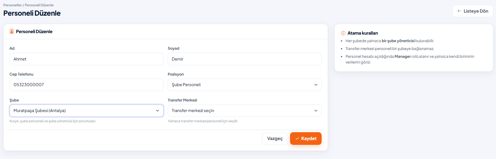
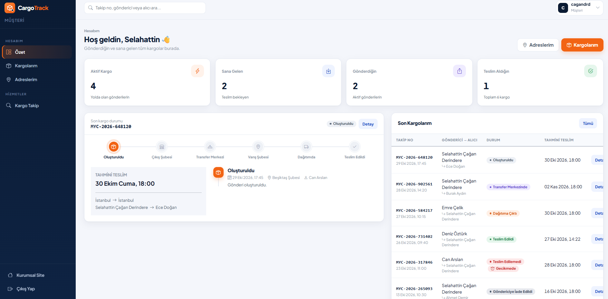

# CargoTrack — Kurumsal Kargo Takip Sistemi

ASP.NET Core MVC (.NET 8) ve N-katmanlı mimari ile geliştirilmiş, rol bazlı yetkilendirilmiş, kargonun kabulünden teslimine kadar her hareketi kayıt altına alan bir kargo operasyon platformu.

> MyAcademy bootcamp **CargoTrack Case Study** kapsamında geliştirilmiştir.



## İçindekiler

- [Özellikler](#özellikler)
- [Ekran Görüntüleri](#ekran-görüntüleri)
- [Mimari](#mimari)
- [Teknolojiler](#teknolojiler)
- [İş Kuralları](#iş-kuralları)
- [Roller ve Yetkiler](#roller-ve-yetkiler)
- [Kurulum](#kurulum)
- [Demo Hesaplar](#demo-hesaplar)
- [Proje Yapısı](#proje-yapısı)

## Özellikler

- **Kargo yaşam döngüsü:** Oluşturuldu → Gönderici Şubesi → Transfer Merkezi → Varış Şubesi → Dağıtım → Teslim. Durumlar rastgele değiştirilemez, izin verilen geçişler durum makinesiyle doğrulanır.
- **Dinamik fiyatlandırma:** Desi (En × Boy × Yükseklik / 3000), ağırlık, mesafe bölgesi (şehir içi, bölge içi, bölgeler arası), teslimat tipi ve ek hizmetlere göre anlık ücret.
- **6 haneli teslimat kodu:** Kurye dağıtıma çıktığında kriptografik olarak üretilir, sadece alıcı görür. Kod doğrulanmadan teslim tamamlanamaz.
- **Başarısız teslimat ve iade:** Neden (adres hatalı, alıcı yok, hasarlı, reddetti) kaydedilir. 3. başarısız denemede iade süreci otomatik başlar.
- **SLA takibi:** Tahmini teslim tarihi iş günü bazında hesaplanır. Geciken gönderiler raporlanır, zamanında teslim oranı ölçülür.
- **Herkese açık takip:** Giriş gerekmeden takip numarasıyla sorgulama. Kişisel veriler maskelenir, QR kod ve barkod üretilir.
- **Rol bazlı dashboard'lar:** Admin, şube müdürü ve müşteri için ayrı paneller, ViewComponent tabanlı kartlar ve grafikler.
- **Performans raporları:** Şube ve personel bazında işlem hacmi, teslimat başarı oranı, gecikme, ortalama teslim süresi ve iade oranı.
- **Audit log:** Tüm ekleme, güncelleme, silme ve durum değişiklikleri eski ve yeni değerleriyle otomatik kaydedilir.
- **Listeleme kalitesi:** Veritabanı seviyesinde sayfalama, arama ve filtreleme.

## Ekran Görüntüleri

### Kurumsal site

| Nasıl çalışır | Hesap oluşturma |
| --- | --- |
|  |  |

### Admin paneli



| Performans raporu | Fiyat tarifeleri |
| --- | --- |
|  |  |

| Sorunlu kargolar | Personel yönetimi |
| --- | --- |
|  |  |

### Müşteri paneli



## Mimari

Proje beş katmandan oluşur. Bağımlılık yalnızca aşağı doğru akar. İş kuralları Business katmanındadır, controller'lar sadece isteği alıp servise iletir.

```
CargoTrack.WebUI        Controller, View, ViewComponent, Partial View, Program.cs (DI)
      │
CargoTrack.Business     Servisler, iş kuralları, Mapster, FluentValidation
      │          └────► CargoTrack.DTO   Create / Update / Result / Filter DTO'ları
CargoTrack.DataAccess   AppDbContext, Fluent API configuration, repository, migration
      │
CargoTrack.Entity       BaseEntity, entity'ler ve enum'lar
```

**İstek akışı:** Controller → Service → Repository → DbContext → SQL Server

## Teknolojiler

| Alan | Teknoloji |
| --- | --- |
| Framework | ASP.NET Core MVC, .NET 8 |
| Veritabanı | SQL Server, Entity Framework Core 8 (Code First, migration, lazy loading) |
| Kimlik doğrulama | ASP.NET Core Identity (Admin, Manager, User rolleri) |
| Nesne dönüşümü | Mapster |
| Doğrulama | FluentValidation (sunucu ve istemci tarafı) |
| Arayüz | Bootstrap 5, Bootstrap Icons, özel tasarım sistemi (Plus Jakarta Sans) |
| Grafik ve kod | Chart.js, QRCode.js, JsBarcode |

**Uygulanan teknik beklentiler:** Async repository, Dependency Injection, DTO, Mapster, FluentValidation, Identity, Role Based Authorization, ViewComponent / Partial View, Global Exception Handling, Pagination, Search & Filtering, Soft Delete, CreatedDate / UpdatedDate, Audit Log.

## İş Kuralları

| Kural | Açıklama |
| --- | --- |
| Durum geçişi | `CargoStatusRules` içindeki geçiş tablosu dışında durum değiştirilemez |
| Teslimat | Sadece dağıtımdaki kargo, doğru 6 haneli kodla teslim edilebilir |
| İade | 3 başarısız teslimat denemesinde kargo otomatik olarak iade sürecine girer |
| Fiyat | Ücret sunucuda hesaplanır, aynı gün teslimat sadece şehir içinde geçerlidir |
| Kargo kabulü | Personel sadece kendi şubesinden gönderi oluşturabilir. Teslimat adresi alıcıya ait ve varış şubesinin şehrinde olmalıdır |
| Şube müdürü | Her şubede yalnızca bir şube yöneticisi bulunabilir |
| Müşteri | Aynı telefon numarası veya e-posta ile ikinci müşteri kaydı açılamaz |
| Tarife | Aynı mesafe bölgesinde aktif desi aralıkları çakışamaz |
| Silme | Kayıtlar soft delete ile silinir. Aktif kargosu veya personeli olan şube silinemez, pasife alınır |

## Roller ve Yetkiler

Rol kontrolü sadece menüleri gizlemekle sınırlı değildir. Veri erişimi servis katmanında, giriş yapan kullanıcının şube veya müşteri bağlamına göre filtrelenir.

| Rol | Kapsam | Dashboard |
| --- | --- | --- |
| **Admin** | Tüm kargolar, şubeler, transfer merkezleri, personeller, kullanıcılar, fiyatlar, audit log ve raporlar | Toplam, aktif ve geciken kargo, teslimat oranı, 7 günlük trafik, durum dağılımı, en yoğun 5 şube |
| **Manager** | Yalnızca bağlı olduğu şubeye gelen ve şubeden çıkan kargolar | Bugün gelen ve çıkan, dağıtımdaki, teslim edilen, geciken ve sorunlu kargolar, son hareketler |
| **User** | Yalnızca gönderici veya alıcı olduğu kargolar ve kendi adresleri | Aktif kargolar, geçmiş teslimatlar, son kargo durumu ve zaman çizelgesi |

## Kurulum

### Gereksinimler

- .NET 8 SDK
- SQL Server (Express yeterli)
- Visual Studio 2022 veya JetBrains Rider

### Adımlar

1. Repoyu klonlayın:

   ```bash
   git clone https://github.com/caganderindere/MYAcademy_CargoTrack.git
   ```

2. `CargoTrack.WebUI/appsettings.Development.json` dosyasındaki bağlantı cümlesini kendi SQL Server'ınıza göre düzenleyin:

   ```json
   "ConnectionStrings": {
     "DefaultConnection": "server=.\\SQLEXPRESS;database=CargoTrackDb;integrated security=true;trustServerCertificate=true"
   }
   ```

3. Startup projesi olarak **CargoTrack.WebUI**'ı seçip uygulamayı çalıştırın (F5).

İlk açılışta migration'lar otomatik uygulanır. Şehirler, roller, admin kullanıcısı ve fiyat tarifeleri seed edilir. `appsettings.json` içinde `DemoData:Enabled` açıksa ve veritabanında şube yoksa örnek bir operasyon ağı da oluşturulur: 3 transfer merkezi, 8 şube, 27 personel, 14 müşteri ve 48 kargo.

## Demo Hesaplar

| Rol | Kullanıcı adı |
| --- | --- |
| Admin | `admin` |
| Manager (Kadıköy Şubesi) | `kadikoy.mudur` |
| Manager (Çankaya Şubesi) | `cankaya.mudur` |
| User (müşteri) | `demo.musteri` |

Şifreler `CargoTrack.WebUI/appsettings.json` dosyasındaki `AdminUser` ve `DemoData` bölümlerinde tanımlıdır.

## Proje Yapısı

```
MyAcademy_CargoTrack.sln
├── CargoTrack.Entity        Entities/, Entities/Enums/, Entities/Common/BaseEntity.cs
├── CargoTrack.DTO           DTOs/ (Cargos, Branch, Employee, Customer, Dashboard, Report, AuditLog...)
├── CargoTrack.DataAccess    Context/, Configurations/, Repositories/, Auditing/, Migrations/
├── CargoTrack.Business      Services/, Rules/, Validators/, Helpers/, Exceptions/
└── CargoTrack.WebUI         Areas/(Admin, Manager, User), Controllers/, ViewComponents/,
                             Views/, Filters/, Seed/, wwwroot/
```

## Geliştirici

**Selahattin Çağan Derindere** · [GitHub](https://github.com/caganderindere)
